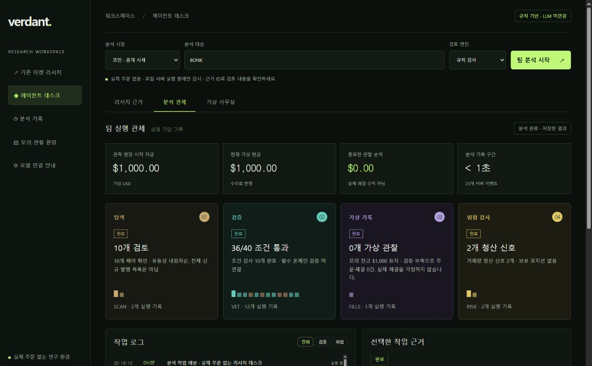
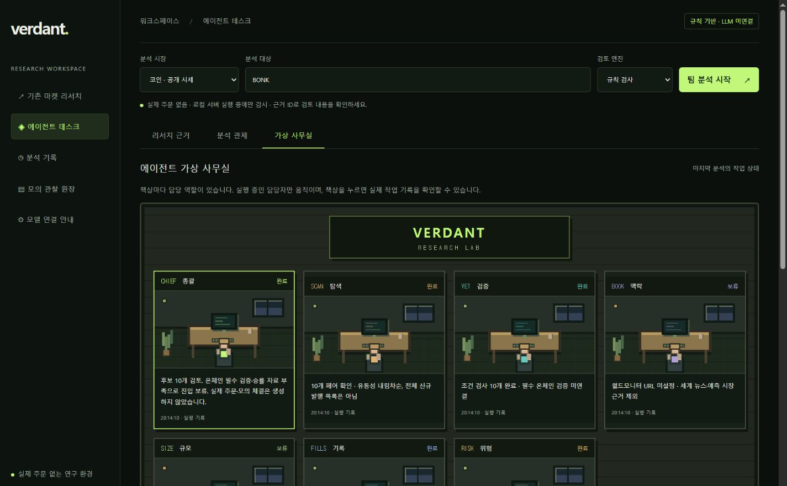

# VERDANT Agent Desk

시장의 소음 너머, 판단의 근거까지.

기존 [VERDANT](https://github.com/gittaeo/verdant-market)에 역할별 실행 기록과 선택형 LLM 검토를 결합한 시장 리서치 도구입니다. 국내 주식과 코인 공개 시세를 구분하며 실제 주문·지갑·거래소 연결 기능은 없습니다.

## 화면

기존 첫 화면은 유지하고 메뉴의 **에이전트 데스크**에서 세 탭을 제공합니다.

- **리서치 근거:** 일곱 역할의 진행 상태, 검사 조건, 출처 ID, 반대 검토, 종합 결과, 원본 자료와 JSON 내보내기.
- **분석 관제:** 탐색 → 검증 → 가상 기록 → 위험 감시 카드, 필터 가능한 서버 로그, 선택한 작업의 근거, 관측 원장 통계.
- **가상 사무실:** 역할별 픽셀 책상과 담당자. 실제 실행 중인 역할만 움직이며 책상에서 동일한 실행 근거를 확인합니다. 장식 그래픽을 데이터 차트로 표현하지 않습니다.





## 바로 실행

Node.js **22.13 이상**에서 별도 패키지 설치 없이 실행합니다.

```powershell
node scripts/local-dashboard.mjs
```

에이전트 데스크: http://127.0.0.1:5177/agents

기존 리서치: http://127.0.0.1:5177

Windows에서는 `Agent-Desk.cmd`를 실행할 수 있습니다. 서버는 PC 내부 주소에만 바인딩합니다. 사용 중인 포트의 다른 프로그램을 종료하지 않으며 `VERDANT_PORT`로 포트를 변경할 수 있습니다.

## 데이터·모델 설정

`config.example.env`를 `.env.local`로 복사하고 필요한 값만 설정한 후 서버를 재시작하세요. 실제 키는 Git이나 채팅에 올리지 않습니다.

| 설정 | 용도 |
| --- | --- |
| `DART_API_KEY`, `KRX_API_KEY` | 국내 주식 공시·일별 가격 |
| `NAVER_NEWS_CLIENT_ID`, `NAVER_NEWS_CLIENT_SECRET` | 기업 뉴스 검색 |
| `KIS_APP_KEY`, `KIS_APP_SECRET` | 외국인·기관 수급 읽기 |
| `VERDANT_OLLAMA_URL`, `VERDANT_OLLAMA_MODEL` | 자체 운영 Ollama 모델 |
| `VERDANT_API_BASE_URL`, `VERDANT_API_MODEL`, `VERDANT_API_KEY` | `/chat/completions` JSON 응답을 지원하는 호환 API |
| `VERDANT_WORLDMONITOR_URL` | 선택형 자체 호스팅 세계 정보 서버 |

로컬 모델과 외부 API를 동시에 설정할 수 있습니다. 화면의 **검토 엔진**에서 규칙 검사 / 로컬 LLM / 외부 API를 선택합니다. 서버 설정이 없는 엔진은 비활성화됩니다. 모델 설정 여부는 연결 성공을 의미하지 않으며 실제 요청 실패를 별도로 표시합니다.

Ollama 예시: URL은 `http://127.0.0.1:11434`, 모델 이름은 실제로 설치한 모델을 사용합니다. 외부 API의 base URL은 제공사의 `/v1` 등 API 기준 주소입니다. 키는 서버에서만 전달합니다. 모델은 자동 설치하거나 다운로드하지 않습니다.

기존의 상위 폴더 `DART API.txt`, `KRX API.txt`, `NEWS API.json`, `KIS API.json` 방식도 지원합니다. 자세한 기존 설정과 자료 범위는 [이전 VERDANT 문서](docs/legacy-verdant.md)를 확인하세요.

## 역할과 실행 방식

| 역할 | 실행하는 작업 |
| --- | --- |
| CHIEF | 작업 배분·종합 결과, 모델 설정 시 근거 기반 총괄 요약 |
| SCAN | DEX 페어 검색 또는 기존 DART·KRX 데이터 수집 |
| VET | 코인 가격·유동성·페어 나이·최근 매수/매도 검사, 주식 자료 연결 범위 확인 |
| BOOK | 주식 공시·뉴스 맥락, 선택형 월드모니터 검사, LLM 근거 검토 |
| SIZE | 검증된 확률·손익비가 있을 때만 켈리·현금 6%·유동성 한도 계산 |
| FILLS | 주문 없이 관측 가격으로 가상 관찰을 기록 |
| RISK | 코인 거래량 비율과 누락 자료 확인, 모델 설정 시 반대 검토 |

일곱 역할은 실제 함수·도구 실행 단위이며, 일곱 개의 독립 모델이 상시 실행되는 구성은 아닙니다. LLM은 BOOK → RISK → CHIEF에서 자료를 검토합니다. 숫자 계산·필수 검사·자금 상한·원장 변경은 코드가 담당하고 LLM이 뒤집을 수 없습니다.

모델 출력은 내부 사고 전체가 아니라 핵심 근거 요약입니다. 제공한 자료 ID만 참조하도록 검사하며, 검증되지 않은 출력은 실패로 표시합니다. ID 검사는 내용의 사실성을 입증하지 않으므로 AI 해석과 원문 사실을 구분합니다.

## 모의 관찰 원장

PC 서버에서 `data/agent-desk/`에 분석 스냅샷과 원장을 저장합니다. 원장 변경은 직렬화하고 임시 파일 후 교체 방식으로 저장합니다.

- 가상 시작 현금 $1,000. 관찰 금액 최소 $50, 남은 현금 6% 이내, 최대 7개 페어.
- 유동성 최소 $10,000 및 관찰 금액의 50배. 수수료는 매수·매도 각각 0.45%, 최소 $0.95 가정.
- 실제 관측 가격을 가상 진입·종료 가격으로 사용합니다. 호가·슬리피지·매도 가능성을 반영한 모의 체결이나 실행 가능한 전략 수익률이 아닙니다.
- 사용자가 부분 통과 페어를 관찰로 기록할 수 있습니다. 자동 진입은 보유자·지갑 집중도·매도 가능성·검증된 승률 자료 부족으로 보류됩니다.
- 서버가 켜져 있는 동안 5분마다 별도 타이머로 관찰 중인 페어를 확인합니다. `h6 / (h24 / 4) < 0.20`이면 새 관측 가격으로 종료를 기록합니다.
- 가격 조회가 실패하면 `unpriced`로 남기고 종료 가격을 생성하지 않습니다. 다음 감시에서 다시 확인합니다. 서버 종료 중에는 감시하지 않습니다.
- 국내 주식에 코인 거래량 청산 규칙을 적용하지 않습니다.

## PC와 호스팅의 차이

| 기능 | PC 서버 | Cloudflare 웹 |
| --- | --- | --- |
| 에이전트 분석·세 가지 보기 | 지원 | 지원 |
| 분석 기록 | 서버 파일, 최근 목록 100개 | 해당 브라우저, 최대 10개 |
| 가상 관찰 원장·5분 감시 | 지원, 서버 실행 중 | 미지원, PC 사용 안내 |
| 로컬 Ollama | 같은 PC의 서버 연결 | localhost 연결 불가, 접근 가능한 모델 서버 필요 |
| 실제 금융 주문 | 없음 | 없음 |

서로 다른 환경의 기록과 키는 자동 동기화되지 않습니다. 웹은 서버 secret을 별도로 설정합니다. 기존 Sites 인증과 audience는 보존합니다.

## 검증

```powershell
node --test tests/*.test.mjs
node --check public/agents.js
node --check public/agent-views.js
```

웹 개발·빌드에는 의존성 설치가 필요합니다.

```powershell
npm run install:ci
npm run build
```

57개 자동 테스트: 기존 국내 주식 데이터·뉴스·수급 검증과 에이전트 이벤트, 취소, 누락값, 켈리 상한, 모델 근거 ID, 모델 실패, 왕복 수수료, 시세 장애, 원장 재시작 복구, 요청 출처·크기 제한, 세계 정보 서버의 빈 응답 처리를 포함합니다.

## 현재 한계와 다음 개발

- 국내 주식 공급원은 키와 상품별 이용 승인이 필요합니다. 새 PC 체크아웃에는 기존 키가 복사되지 않습니다.
- 코인 검색은 동일 이름의 다른 자산·체인·페어를 포함합니다. 계약 주소와 체인을 확인하세요. 전체 신규 발행 탐색·보유자 증가·실소유자 집중도·매도 시뮬레이션은 미연결입니다.
- 예측 시장의 질문 매칭·가격 비교·확률 추정·베팅은 미구현입니다. 월드모니터 기본 설치의 빈 데이터는 degraded로 표시합니다.
- 전략의 적중률·미래 수익률·승률을 입증하지 않았습니다. 모델 사전학습·미세조정도 수행하지 않았습니다.
- 자체 모델 미세조정은 검수한 근거·분석 결과·평가 데이터가 쌓인 뒤 별도 평가로 진행합니다. [개발 설계](docs/agent-desk.md)를 참고하세요.

## 참고

[트레이딩 팀 역할 분리 가이드](https://lazyowen.com/guides/grok-bot-trading-team-setup)의 역할 분리·모의 운영 아이디어를 참고해 구현했습니다. Grok 앱을 원격 제어하는 제품이 아니며 프롬프트 원문이나 외부 프로젝트 코드를 복사하지 않았습니다.

[DEX Screener API](https://docs.dexscreener.com/api/reference) · [Ollama API](https://docs.ollama.com/api/introduction) · [Worldmonitor](https://github.com/koala73/worldmonitor)
