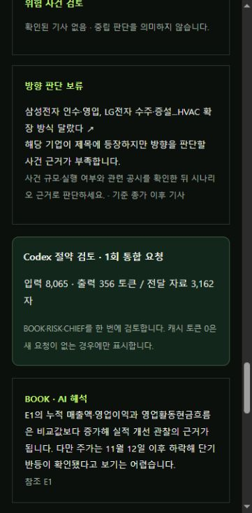

# Codex 개인 연결 · 2026-11-17

새 저장소를 기준으로 주식 요약·사무실 이동·검토 엔진 점검을 확장했습니다. 모델 다운로드·훈련은 수행하지 않았습니다.

## PC에서 사용

1. `Agent-Desk.cmd` 실행. 같은 체크아웃의 최신 서버를 재사용하며 다른 프로그램이나 이전 저장소가 포트를 사용하면 다음 포트를 찾습니다. 다른 프로세스는 종료하지 않습니다.
2. `검토 엔진`에서 `Codex · 1회 절약 검토`를 선택합니다. 기본 규칙 검사는 모델 토큰을 쓰지 않습니다.
3. 기업 또는 코인을 분석합니다. 숫자·필수 검사는 코드가 수행하고, BOOK/RISK/CHIEF를 Codex 한 번으로 함께 검토합니다.
4. 사무실에서 `분석 결과 보기`로 종합 결과를 확인합니다. `연결·엔진 점검`에서 짧은 예제 응답·JSON·근거 ID 형식을 점검할 수 있습니다. 점검 버튼도 실제 모델 요청이므로 필요할 때만 사용합니다.

설정은 Git에서 제외한 `.env.local`의 `VERDANT_CODEX_ENABLED=1`. `codex login`으로 로그인한 기존 CLI 인증을 사용합니다. `VERDANT_CODEX_BIN`은 선택적 실행 파일 경로, `VERDANT_CODEX_MODEL`은 선택적 모델 이름입니다. 비어 있으면 CLI 기본 모델을 사용합니다. 로그인 파일을 읽어 복사하거나 인증 토큰을 브라우저·GitHub·호스팅으로 전달하지 않습니다.

## 사용량 절약

- 기본값 규칙 검사, Codex는 사용자가 선택한 실행에서만 사용.
- 실제 에이전트 7회 호출이 아닌, 3가지 관점의 1회 통합 요청.
- 원자료를 약 6천 자 이내로 압축하며 뉴스·가격·연결 범위를 우선 제공. 잘린 자료는 truncated로 명시.
- 직전 AI 해석은 사실 자료로 다시 입력하지 않음.
- 동일한 압축 자료·모델을 15분간 메모리 캐시(최대 20개)로 재사용. 서버 재시작 시 캐시 소멸. 새 자료는 새 요청.
- 짧은 전용 모델 지침, low 추론 설정, 짧은 요약. Codex 기본 지침·구조화 출력도 토큰을 사용하므로 6천 자가 토큰 상한은 아닙니다.
- Codex JSONL의 실제 input/output/cached-input 사용량을 보관. 제공되지 않은 값은 미제공으로 표시. 앱 캐시 재사용 시 새 호출·토큰 0.
- 자동 재시도·상시 모델 추론 없음. 오류가 나면 기존 규칙 결과 유지. 분석 취소/90초 제한 시 자신이 실행한 CLI 자식 프로세스를 종료.

## 실행 경계

`codex exec`를 shell 없이 실행합니다. 읽기 전용, 임시 작업 디렉터리·ephemeral 세션·웹/셸/멀티 에이전트 도구 비활성화. 사용자 config를 변경하지 않고 해당 프로세스에만 짧은 지침을 적용합니다. 주식/뉴스/외부 모델 API 키는 자식 환경변수에서 제외합니다. 실행 이벤트에서 도구 호출이 관측되면 결과를 보류합니다.

응답은 BOOK/RISK/CHIEF 세 역할의 JSON과 제공한 원자료 ID만 허용합니다. 이것이 내용의 금융 정확도나 미래 수익성을 검증하지는 않습니다. 압축으로 자료 일부가 빠질 수 있으므로 원문·반대 근거 확인이 필요합니다.

**호스팅 웹에는 로컬 Codex 모드가 비활성화됩니다.** PC의 로그인·프로세스를 Cloudflare에서 사용할 수 없습니다. 개인 Codex 연결은 PC 실행본에서 사용합니다. 웹에서는 설정된 다른 모델 또는 규칙 검사와 동일한 결과 화면을 제공합니다.

## 검증

- 전체 자동 테스트 73개 통과. 압축 크기·참조 ID·중복 역할·캐시·분할 UTF-8·취소·시간 초과·실패 시 규칙 유지·호스팅 차단 검사 포함.
- 실제 ChatGPT CLI 로그인 상태 확인, 예제 3역할 응답 및 근거 ID 검증 성공.
- 짧은 예제 측정: 초기 입력 11,284/출력 179 → 전용 지침 적용 후 입력 7,149/출력 189. 같은 자료 재요청은 앱 캐시로 추가 입력·출력 0. 서로 다른 출력이므로 통제된 성능 비교는 아닙니다.
- 실제 삼성전자 조회: 공시 43건·최근 종가 5개 수집 후 Codex 입력 8,065/출력 356, 1회 요청. 실제 분석의 연결 확인이며 금융 정확도·예측 성능 검증이 아닙니다.

## 공식 근거

- [Codex 비대화형 실행: 기존 로그인·JSONL·출력 스키마](https://developers.openai.com/codex/noninteractive/)
- [Codex 설정: 전용 model_instructions_file](https://developers.openai.com/codex/config-reference/)

브라우저 검수: PC 5177 실행기 재사용과 과거 삼성전자 분석 재열기 확인. 사무실 집중 보기에서 연결 점검 창 및 종합 결과로 이동 확인. 확인한 361px 화면의 문서 가로 넘침 없음, 브라우저 오류 로그 없음. 웹 프로덕션 빌드 통과. 개인 Codex 연결은 PC에서만 제공하며 기존 배포의 소유자 전용 범위를 유지합니다.
